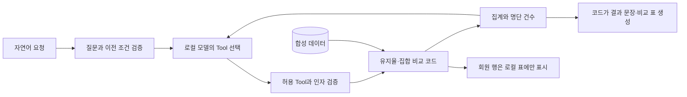

# 구조와 데이터 흐름



모델이 설명한 숫자를 그대로 확정하지 않고, 계산한 집계로 결과 문장을 생성합니다. 명단 Tool은 모델에 행을 돌려주지 않습니다. Tool 호출·검증된 인자·집계·실행 시간은 관찰 대상으로 두고 내부 추론은 공개하지 않습니다.

## 한 실제 관찰의 흐름

[새 로컬 모델 기록](../output/observed/llm-run-001.json)에서는 전체 하락 분석 요청에 모델이 `read_retention_declines`를 선택했고, 계산 집계 후 요청이 종료됐습니다. 이 사례만으로 여러 Tool의 자율 계획 성공을 주장하지 않습니다.

```text
자연어 → read_retention_declines → 합성5강습 비교 → 집계 → 결과 표시
```

## 가능한 확장 흐름

```text
강습 검색 → 하락 분석 → 결과에서 한 강습 선택 → 미등록 명단 표시
```

이 순서는 설계 가능한 경로의 예입니다. 실제 로컬 모델의 전체 경로 관찰 기록과 같은 것으로 취급하지 않습니다. 로직·모의 모델 검사와 실제 모델 관찰은 [output 분류](../output/README.md)대로 구분합니다.

특정 업무 시스템으로 확장할 때는 승인된 별도 어댑터가 인증·권한·조회 계약을 담당하도록 경계를 둘 수 있습니다. 이 저장소에는 그 실제 매핑이나 인증정보를 포함하지 않습니다.
