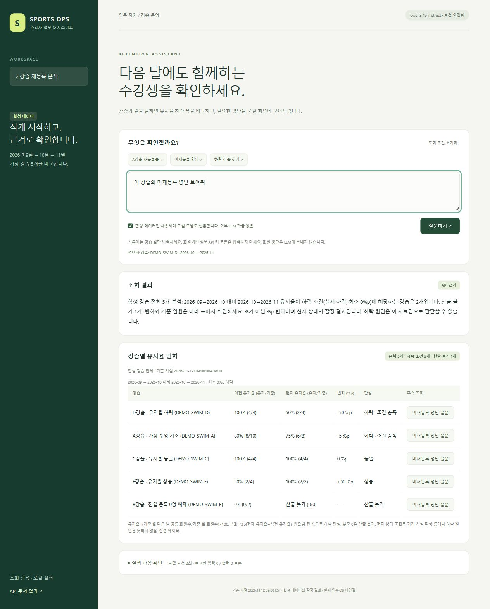

# output 출처와 읽는 방법

| 폴더 | 의미 | 포함 자료 |
| --- | --- | --- |
| observed/ | 실제 로컬 모델 실행을 관찰 | 입력·검증된 ToolTrace·집계·전체 요청 시간·보고된 토큰·구현/fixture/스키마 해시 |
| observed-deterministic/ | 모델 없이 실제 계산 함수를 실행 | 유지율 JSON, 하락 JSON/CSV, 기대값 대비 실제값10건 |
| reference/ | 확인 기준과 산술 입력 | 사전에 정한 기대값, 필터 뒤 합성 월별 회원 집합 |
| simulated/ | 모의 모델 선택으로 확인한 화면 | 비교 표 이미지와 provenance.json |

## 실제 관찰

[llm-run-001.json](observed/llm-run-001.json)은 이번 공개용 합성 구현에서 새로 얻은1회 기록입니다. 이전 구현의 측정값을 복사해 새 실행으로 표시하지 않았습니다. 모델 내부 추론·전체 시스템 프롬프트·인증정보·개인 로컬 경로는 저장하지 않습니다.

## 계산 결과 확인

1. [기대값](reference/expected-results.json)을 봅니다.
2. [합성 집합](reference/eligible-cohorts.json)으로 기준/다음 달 교집합과 분모를 계산합니다.
3. [실제 계산 JSON](observed-deterministic/retention-declines.json), [CSV](observed-deterministic/retention-declines.csv)와 비교합니다.
CSV의 빈칸은 JSON의 null/산출 불가에 대응하며0%와 구분합니다.

4. [계산·입력 검증10건](observed-deterministic/checks.json)의 범위와 실제값을 확인합니다.

이 자료로 산술은 검토할 수 있지만 LLM 실행·원본 등록행 필터링·전체 앱을 독립 재현할 수는 없습니다. 실행 소스는 이 패키지에 없습니다.

## 화면 자료

아래는 이전 합성UI 검사에서 모의 모델 응답을 사용한 화면입니다. 실제 모델 선택의 증거로 사용하지 않습니다. [출처와 한계](simulated/provenance.json)를 함께 확인하세요.

## 갱신 규칙

입력·데이터/구현·스키마가 바뀌면 새 record ID로 실행하고 기존 결과를 덮어써 다른 실행처럼 만들지 않습니다. 실패와 미확인을 함께 남깁니다. 단일 사례나 검사 통과 건수를 정확도·업무효율 개선 수치로 바꾸지 않습니다.

## 해시 확인

실제 관찰 JSON의 `tool_schema_sha256`은 파싱한 스키마를 UTF-8 JSON으로 정규화한 SHA-256입니다. 옵션은 `sort_keys=true`, `ensure_ascii=false`, 구분자 `", "`/`": "`이며 `hash_methods`에 기록했습니다. 공개 파일 자체의 바이트 해시는 `tool_schema_file_sha256`으로 별도 제공합니다. 구현/fixture 해시는 공개하지 않은 원본 스냅샷을 식별하므로 공개 파일의 해시와 혼동하지 않습니다.
